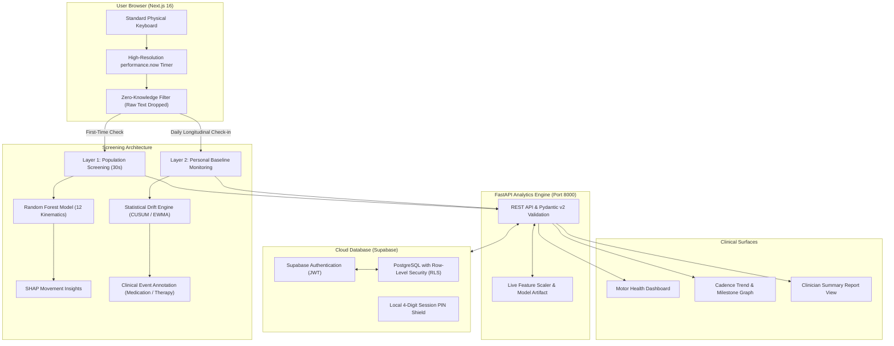

# ParkinTrace 🌿

> **Privacy-First Digital Biomarker Platform for Neuromuscular Rhythm Screening & Longitudinal Monitoring**  
> *Research Aid & Academic Capstone — Not an Autonomous Diagnostic Device.*

ParkinTrace analyzes how you naturally type on a standard computer keyboard. By measuring the microsecond duration each key is held (**Hold Time**) and the transitions between keypresses (**Flight Time**), it detects subtle variations in motor fluidity without ever recording, storing, or reading the words you type.

---

## 🏛️ System Architecture & Workflow



---

## ✨ Core Features

### 1. Two Complementary Screening Layers
- **Layer 1 — Population Screening (Quick Check)**:
  - 30-second assessment measuring 12 canonical kinematic features.
  - Benchmarked against lab-validated reference distributions (ROC-AUC: 0.821).
  - Immediate percentile feedback with SHAP movement explainability.
  - Completely anonymous — no account or login required.
- **Layer 2 — Personal Longitudinal Baseline**:
  - Calibrates a frozen baseline after 10 daily sessions across 5+ calendar days on your physical keyboard.
  - Employs Statistical Process Control (CUSUM, EWMA) to separate diurnal fatigue from genuine motor trend shifts.
  - Protected with a personal 4-digit session PIN on shared computers.

### 2. Standardized Equal-Length Typing Engine
- Calibrated bank of **8 distinct natural English prompts**, every single sentence calibrated to the **exact same length (170 characters)**.
- Successive sessions automatically rotate prompts so repeated tests never show duplicate sentences while preserving identical cognitive load and motor kinematics.

### 3. Clinical Milestones & Event Correlator
- Log significant life or medical events (medication adjustments, dosage changes, physical therapy start).
- Real-time vertical milestone flags appear on the cadence timeline to correlate hold/flight changes with clinical interventions.
- Exportable **Report View** summarizing baseline adherence, drift status, and cadence intervals.

### 4. Absolute Privacy by Design
- **Zero Raw Text Stored**: Characters and words are discarded immediately in transient memory. Only duration deltas ($t_{\text{up}} - t_{\text{down}}$) are computed.
- **Decoupled Telemetry**: No key identities are stored or transmitted.
- **Hardware Anchored**: Anchors to physical switch latency to prevent device discrepancies.
- **Tracey the Mascot Companion**: Visual friendly mascot guiding participants across testing, calibration, and review phases.

---

## 🛠️ Tech Stack

| Tier | Technologies |
|---|---|
| **Frontend** | Next.js 16 (App Router), React 19, TypeScript, Tailwind CSS 4, Recharts |
| **Backend** | FastAPI (Python 3.10), Uvicorn, Scikit-learn 1.6.1, NumPy, SciPy, SHAP |
| **Database & Auth** | Supabase PostgreSQL 15, Row-Level Security (RLS), JWT Claims |
| **Testing** | Vitest (50 frontend tests), Pytest (54 backend tests) |

---

## 🚀 Getting Started

### 1. Start the Backend (FastAPI)
```bash
cd backend
python -m venv venv
# Windows:
venv\Scripts\activate
# macOS/Linux: source venv/bin/activate

pip install -r requirements.txt
python -m uvicorn app.main:app --port 8000 --reload
```
> Verify health at [http://127.0.0.1:8000/api/v1/health](http://127.0.0.1:8000/api/v1/health) (reports `status: "ok"`).

### 2. Start the Frontend (Next.js)
```bash
# In the project root directory:
npm install
npm run dev
```
> Open your browser at [http://localhost:3000](http://localhost:3000).

---

## 🧪 Running Automated Tests

```bash
# Frontend test suite (50 tests):
npx vitest run

# Backend test suite (54 tests):
python -m pytest backend/tests

# Production build verification:
npm run build
```

---

## 📋 Clinical Research Disclaimer
*ParkinTrace is developed for research demonstration and academic evaluation. It provides objective digital biomarker measurements to support clinical discussions and motor trend observation. It does not replace formal neurological examination or provide autonomous medical diagnosis.*
